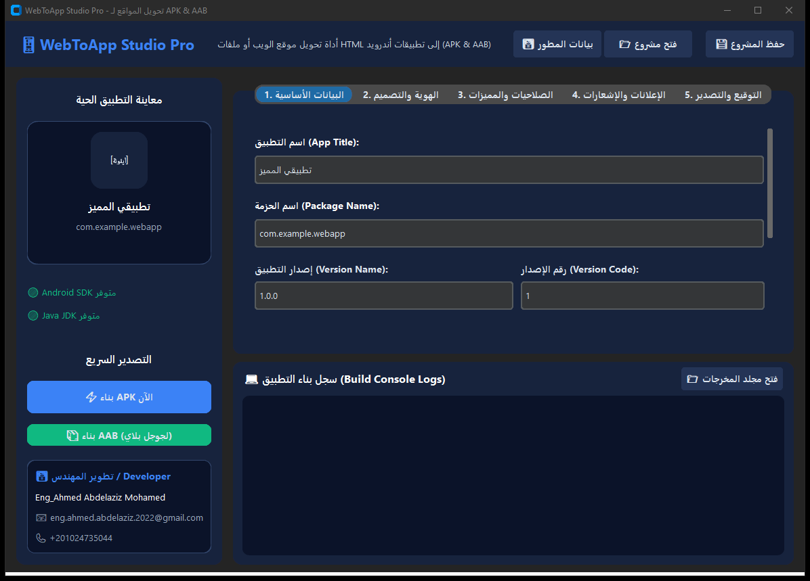
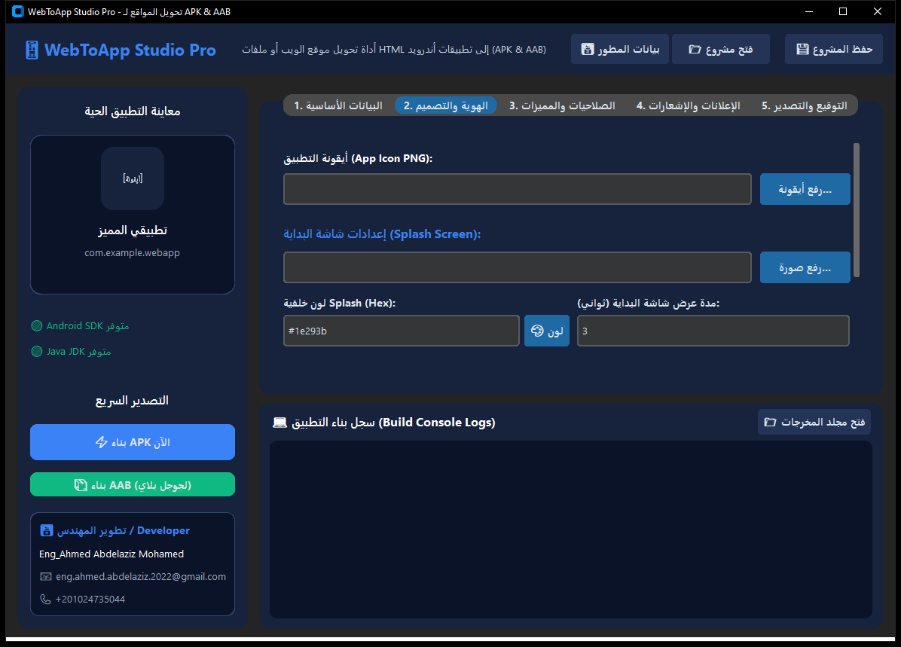
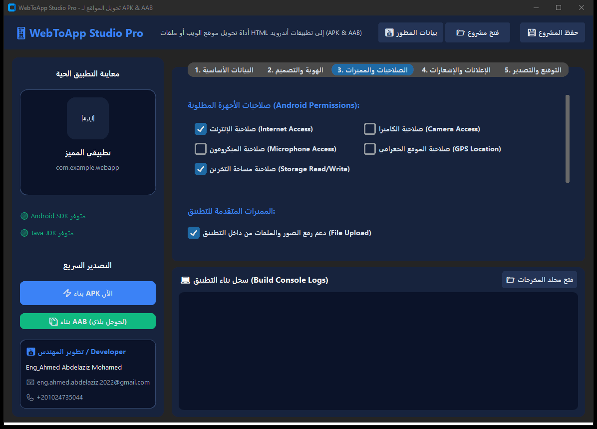
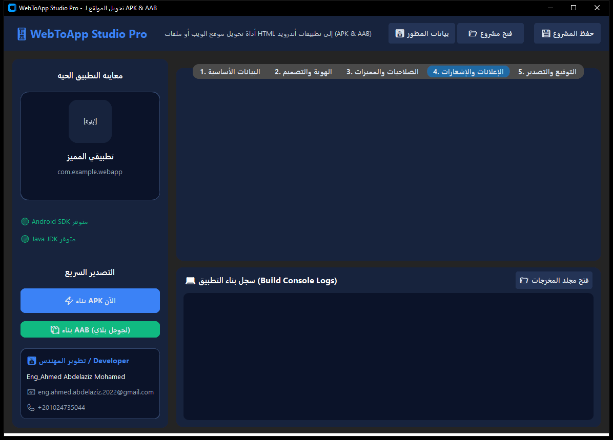
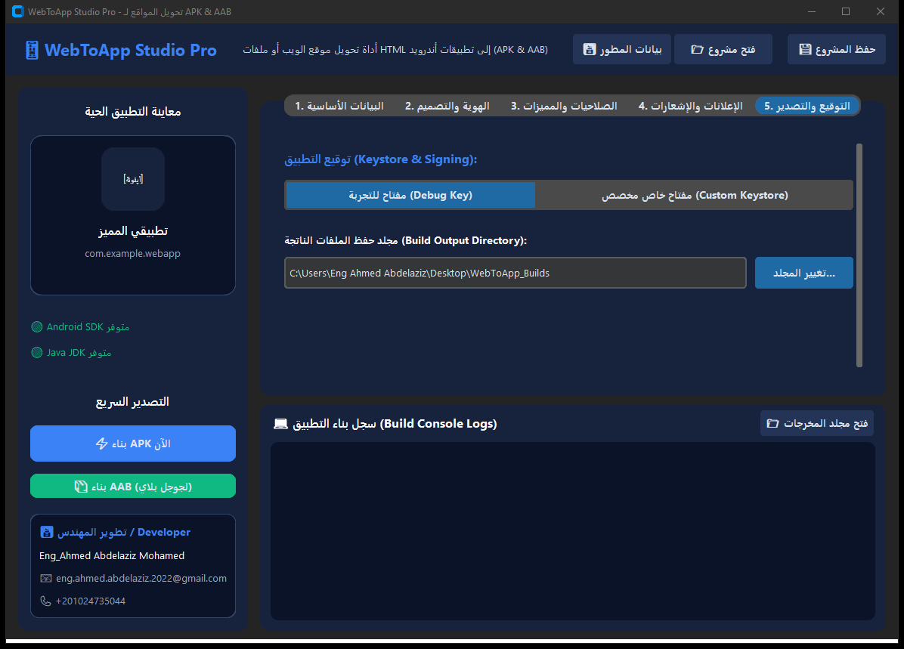
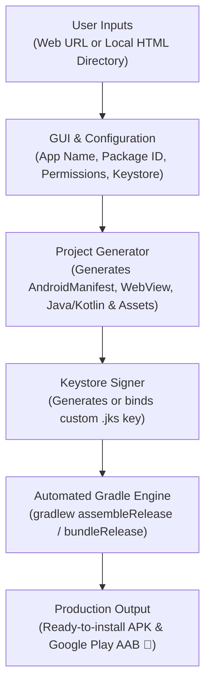

<div align="center">

# 📱 WebToApp Studio Pro

[](https://www.python.org/)
[](https://github.com/TomSchimansky/CustomTkinter)
[](https://developer.android.com/studio)
[](https://gradle.org/)
[](https://microsoft.com/windows)
[](LICENSE)
[](https://github.com/Eng0Ahmed/WebToApp-Studio-Pro/releases)

<br/>



<br/>

**برنامج سطح مكتب احترافي ومتكامل لتحويل مواقع الويب ومشاريع HTML5 المحلية إلى تطبيقات أندرويد أصلية (APK & AAB)**
<br/>
*A modern, powerful Desktop Suite to convert Web URLs or Local HTML5 projects into native Android Applications (APK & AAB) with full Keystore signing, AdMob, and Push Notifications.*

</div>

---

## 🌟 Overview / نظرة عامة

### English:
**WebToApp Studio Pro** is an all-in-one desktop application built with Python and an ultra-modern Web UI (HTML5/CSS3/JavaScript powered by `pywebview`) with seamless fallback to CustomTkinter. It is designed to convert responsive websites and offline HTML5/CSS/JavaScript directories into production-ready Android applications (`.apk` and `.aab`). It features bilingual support (Arabic RTL / English LTR), Dark & Light theme switcher, interactive real-time smartphone mockup, drag & drop, dynamic Keystore generation, permissions toggles, AdMob monetization, OneSignal push notifications, and integrated Gradle compilation without requiring Android Studio.

### العربية:
**WebToApp Studio Pro** هو برنامج سطح مكتب متكامل واحترافي مبني بلغة بايثون وواجهة ويب عصرية فائقة الجمال (HTML5/CSS3/JS عبر `pywebview`) مع دعم كامل للواجهة الكلاسيكية (CustomTkinter). يتيح للمطورين وأصحاب المواقع تحويل مواقع الويب وملفات HTML5/CSS/JS المحلية إلى تطبيقات أندرويد حقيقية بصيغتي (`APK` للتثبيت المباشر و `AAB` للرفع على متجر Google Play)، مع دعم كامل للغتين العربية (RTL) والإنجليزية (LTR)، والتبديل بين الوضع المظلم والمضيء، ومحاكي هاتف تفاعلي للمعاينة الحية، وميزة السحب والإفلات، وتوليد مفاتيح التوقيع الرقمي (Keystore)، ودمج إعلانات AdMob وإشعارات OneSignal وتجميع Gradle تلقائياً دون الحاجة لتثبيت Android Studio المعقد.

---

## 📸 واجهات البرنامج (Screenshots & UI Showcase)

<div align="center">

### 1️⃣ البيانات الأساسية ومصادر المحتوى (Basic Settings)


### 2️⃣ الهوية والتصميم ومعاينة الأيقونة المباشرة (Branding & Live Preview)


### 3️⃣ إدارة الصلاحيات ومميزات التصفح (Permissions & Features)


### 4️⃣ تحقيق الدخل والإشعارات التفاعلية (Monetization & Push Notifications)


### 5️⃣ مولّد مفاتيح التوقيع والتصدير النهائي (Keystore Generator & Build Output)


</div>

---

## 🏗️ Architecture & Build Pipeline / آلية العمل وهندسة التجميع



---

## ✨ المميزات الرئيسية (Key Features)

### ⚙️ 1. إعدادات التطبيق الأساسية (App Settings)
- **اسم التطبيق (App Title)**: تسمية التطبيق واقتراح اسم حزمة الـ APK التلقائي.
- **اسم الحزمة (Package Name)**: دعم تخصيص المعرف الفريد للتطبيق (مثال: `com.company.myapp`).
- **تخصيص الإصدارات**: إمكانية إدخال `Version Name` و `Version Code`.
- **دعم مصادر المحتوى**:
  - **رابط موقع (Web URL)**: تحويل أي موقع إلكتروني مباشر إلى تطبيق هجين نشط.
  - **مجلد محلي (Local HTML Directory)**: تحويل ملفات HTML/CSS/JS المحلية إلى تطبيق أوفلاين 100%.

### 🎨 2. الهوية والتصميم (Branding & UI Customization)
- **أيقونة التطبيق (App Icon)**: تحويل وتوليد كافة الأحجام الدقيقة المطلوبة للأندرويد تلقائياً (`mdpi`, `hdpi`, `xhdpi`, `xxhdpi`, `xxxhdpi`).
- **شاشة البداية (Splash Screen)**: تخصيص صورة اللوجو، ولون الخلفية، ومدة العرض بالثواني.
- **خصائص WebView المتطورة**:
  - السحب للتحديث (Pull-to-Refresh).
  - شريط تقدم التحميل (Progress Bar) بلون مخصص.
  - التكبير والتصغير بأصابع اليد (Pinch-to-Zoom).

### 🔒 3. إدارة الصلاحيات والمميزات المتقدمة (Permissions & Features)
- **إدارة الصلاحيات بـ Checkboxes**: (Internet, Camera, Microphone, GPS Location, Storage).
- **رفع وتنزيل الملفات**: دعم رفع الصور والملفات عبر `WebChromeClient` وتنزيل الملفات عبر `DownloadListener`.
- **تشغيل الوسائط**: دعم كامل لتشغيل فيديوهات HTML5 والصوتيات وتخزين الكاش.
- **وضع الرابط الخارجي (External Links)**: اختيار فتح الروابط الخارجية داخل التطبيق أو عبر المتصفح الافتراضي.

### 💰 4. تحقيق الدخل والإشعارات (Monetization & Push)
- **Google AdMob**: دمج إعلانات البانر (Banner) والإعلانات البينية (Interstitial) برقم المعرف الخاص.
- **OneSignal**: دمج إشعارات Push Notifications التفاعلية.

### 🔑 5. التوقيع الرقمي والتصدير (Keystore & Output)
- **مولّد مفاتيح مدمج (Keystore Generator)**: أداة مدمجة لتوليد مفتاح توقيع مخصص (`.jks`) عبر `keytool` دون كتابة أوامر.
- **خيارات التوقيع**: التوقيع بمفتاح تجريبي (Debug) أو مفتاح خاص مخصص (Custom Release Key).
- **تصدير APK & AAB**: بنقرة زر واحدة لبناء ملفات جاهزة للتثبيت المباشر أو الرفع على متجر **Google Play**.

---

## 🛠️ هيكلية المشروع (Project Architecture)

```
WebToApp-Studio-Pro/
├── main.py                          # نقطة الانطلاق وتشغيل البرنامج
├── WebToApp Studio Pro.spec         # تكوين محرك PyInstaller للبناء
├── requirements.txt                 # مكتبات بايثون المطلوبة
├── screenshots/                     # صور حية لكافة واجهات البرنامج
│   ├── 01_basic_settings.png
│   ├── 02_branding_ui.png
│   ├── 03_permissions_features.png
│   ├── 04_monetization_push.png
│   └── 05_signing_export.png
├── gui/
│   ├── app_window.py                # واجهة المستخدم الرئيسية المحدثة بـ CustomTkinter
│   ├── theme.py                     # نظام التصميم الألوان والخطوط العصرية
│   └── keystore_dialog.py           # نافذة توليد مفتاح التوقيع الرقمي Keystore
├── backend/
│   ├── config_manager.py            # إدارة وحفظ إعدادات المشروع (.wtaproj)
│   ├── project_generator.py         # مولّد كود مشروع الأندرويد و AndroidManifest و WebView
│   ├── builder.py                   # محرك تشغيل وتتبع Gradle والتصدير الفعلي
│   └── sdk_utils.py                 # مكتشف Android SDK و JDK ومحرك Gradle
├── templates/
│   ├── offline.html                 # قالب صفحة الانقطاع التفاعلية في حال غياب الإنترنت
│   └── gradle-wrapper.jar           # مكتبة البناء التلقائية لـ Gradle
├── .github/workflows/
│   └── build-exe.yml                # سير عمل GitHub Actions لبناء ملف الـ EXE تلقائياً
├── .gitignore
├── LICENSE                          # ترخيص MIT الرسمي
└── README.md
```

---

## 🚀 كيفية التشغيل والتطوير (Getting Started)

### 1️⃣ المتطلبات الأساسية (Prerequisites)
- نظام تشغيل **Windows 10 / 11**
- **Python 3.11+**
- **Java JDK (8 أو 11 أو 17)** وأدوات **Android SDK Build-Tools**

### 2️⃣ التثبيت (Installation)
قم باستنساخ المستودع وتثبيت المكتبات المطلوبة:

```bash
git clone https://github.com/Eng0Ahmed/WebToApp-Studio-Pro.git
cd WebToApp-Studio-Pro
pip install -r requirements.txt
```

### 3️⃣ تشغيل البرنامج (Run Application)
```bash
python main.py
```

### 4️⃣ بناء ملف تنفيذي (.exe) مستقل
لتوليد نسخة `.exe` جاهزة للعمل دون الحاجة لتثبيت بايثون:

```bash
pyinstaller "WebToApp Studio Pro.spec"
```
ستجد الملف الناتج داخل مجلد `dist/WebToApp Studio Pro.exe`.

---

## 📦 تحميل النسخة الجاهزة للتشغيل (Pre-built Release)

يمكنك تحميل ملف البرنامج التنفيذي المباشر (`WebToApp.Studio.Pro.exe`) دون الحاجة لتثبيت بايثون من صفحة الإصدارات:  
👉 **[تحميل أحدث إصدار من Releases](https://github.com/Eng0Ahmed/WebToApp-Studio-Pro/releases)**

---

## 👤 المطور (Developer)

تم التطوير بكل فخر بواسطة **م. أحمد عبد العزيز (Eng Ahmed Abdelaziz)**

- 📧 **البريد الإلكتروني:** [eng.ahmed.abdelaziz.2022@gmail.com](mailto:eng.ahmed.abdelaziz.2022@gmail.com)
- 💬 **واتساب:** [+201024735044](https://wa.me/201024735044)
- 🐙 **حساب GitHub:** [@Eng0Ahmed](https://github.com/Eng0Ahmed)

---

## 📜 الترخيص (License)

هذا المشروع مرخص بموجب ترخيص **MIT** - راجع ملف [LICENSE](LICENSE) لمزيد من التفاصيل.
